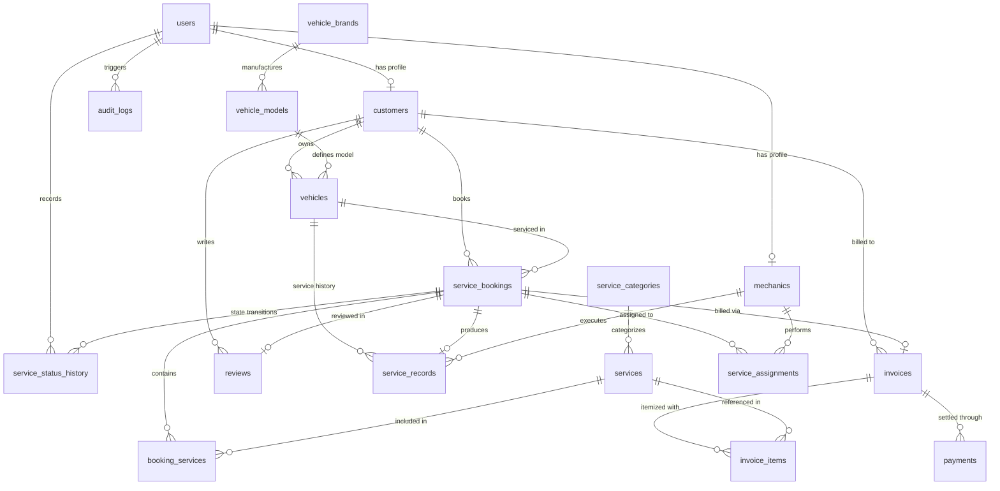

# Database Design & Relational Schema Architecture

**Project:** Vehicle Service Management System  
**Academic Course:** Advanced Database Management Systems (ADBMS)  
**Database Engine:** PostgreSQL 16+ / 18  

---

## 1. Executive Design Summary

The database architecture for the Vehicle Service Management System is designed to model the full business lifecycle of an automotive repair center—from customer onboarding and automobile asset registration to multi-service appointment scheduling, technician allocation, work execution logging, billing itemization, and payment reconciliation.

The schema comprises **18 relational tables**, all adhering strictly to **Third Normal Form (3NF)**. Business rules are enforced at the database layer using domain ENUMs, primary keys, foreign keys with referential constraints, `CHECK` constraints, composite unique indexes, triggers, user-defined functions, and stored procedures.

---

## 2. Normalization Analysis & Proofs

### First Normal Form (1NF)
> **Requirement:** Each table cell must contain a single atomic value, each column must contain values of the same domain, and there must be no repeating groups.

* **Atomic Attributes:** All multi-valued real-world entities are separated into distinct records. For example, rather than storing multiple services requested for an appointment as a comma-separated string in `service_bookings`, a dedicated bridge table `booking_services` models the $(M:N)$ relationship with discrete `(booking_id, service_id)` composite tuples.
* **Granular Attributes:** Address fields in `customers` are atomized into `address`, `city`, `state`, and `postal_code` rather than stored in a single combined text block.
* **No Repeating Groups:** Instead of creating columns like `service_1`, `service_2`, `service_3`, individual requested services are normalized as separate rows in `booking_services`.

### Second Normal Form (2NF)
> **Requirement:** The relation must be in 1NF, and every non-prime attribute must be fully functionally dependent on the entire primary key (no partial functional dependencies).

* In `booking_services`, the composite primary key is `(booking_id, service_id)`. The non-prime attributes are `unit_price` and `notes`. The `unit_price` stored represents the historical locked-in tariff for that specific service *within that specific booking* (preventing invoice drift when base catalog prices change). It is fully dependent on both `booking_id` and `service_id`.
* Attributes descriptive of the service itself (such as `name`, `description`, `estimated_duration_minutes`) depend solely on `service_id` and are properly housed in the `services` table, eliminating partial dependencies.
* In `invoice_items`, the primary key is surrogate `id`, and all attributes depend solely on that key.

### Third Normal Form (3NF)
> **Requirement:** The relation must be in 2NF, and no non-prime attribute may be transitively dependent on the primary key ($X \to Y$ and $Y \to Z$ where $Z$ is non-prime).

* **Vehicle Model Normalization:** In `vehicles`, storing the manufacturer country alongside the car would introduce a transitive dependency:  
  $\text{vehicle\_id} \to \text{model\_id} \to \text{brand\_id} \to \text{country}$.  
  To eliminate this, the model and manufacturer hierarchies are segregated into `vehicle_brands` and `vehicle_models`. `vehicles` references only `model_id`.
* **Customer Profile Normalization:** User authentication (`email`, `password_hash`, `role`) is isolated in `users`. Physical addresses and emergency contacts reside in `customers`. Workshop technician attributes (`specialization`, `hourly_rate`, `experience_years`) reside in `mechanics`. Neither table duplicates authentication state.
* **Invoice Financial Separation:** Payment records (`payments`) are independent of invoice line items (`invoice_items`). Invoices store aggregated accounting checkpoints (`subtotal`, `tax_amount`, `total_amount`), which are synchronized via database triggers (`trg_invoice_items_recalc`).

---

## 3. Functional Dependencies & Keys

### Relation 1: `users`
* **Primary Key:** `id`
* **Candidate Keys:** `{id}`, `{email}`
* **Functional Dependencies:**
  * $\text{id} \to \text{email}, \text{password\_hash}, \text{role}, \text{full\_name}, \text{phone}, \text{is\_active}, \text{created\_at}, \text{updated\_at}$
  * $\text{email} \to \text{id}, \text{password\_hash}, \text{role}, \text{full\_name}, \text{phone}, \text{is\_active}$

### Relation 2: `customers`
* **Primary Key:** `id`
* **Candidate Keys:** `{id}`, `{user_id}`
* **Foreign Keys:** `user_id \to users(id)` (ON DELETE CASCADE)
* **Functional Dependencies:**
  * $\text{id} \to \text{user\_id}, \text{address}, \text{city}, \text{state}, \text{postal\_code}, \text{emergency\_contact}$
  * $\text{user\_id} \to \text{id}, \text{address}, \text{city}, \text{state}, \text{postal\_code}$

### Relation 3: `mechanics`
* **Primary Key:** `id`
* **Candidate Keys:** `{id}`, `{user_id}`
* **Foreign Keys:** `user_id \to users(id)` (ON DELETE CASCADE)
* **Functional Dependencies:**
  * $\text{id} \to \text{user\_id}, \text{specialization}, \text{experience\_years}, \text{hourly\_rate}, \text{status}, \text{is\_available}$

### Relation 4: `vehicle_brands`
* **Primary Key:** `id`
* **Candidate Keys:** `{id}`, `{name}`
* **Functional Dependencies:**
  * $\text{id} \to \text{name}, \text{country}$
  * $\text{name} \to \text{id}, \text{country}$

### Relation 5: `vehicle_models`
* **Primary Key:** `id`
* **Candidate Keys:** `{id}`, `{(brand_id, model_name)}`
* **Foreign Keys:** `brand_id \to vehicle_brands(id)` (ON DELETE RESTRICT)
* **Functional Dependencies:**
  * $\text{id} \to \text{brand\_id}, \text{model\_name}, \text{body\_type}, \text{fuel\_type}$
  * $\text{brand\_id}, \text{model\_name} \to \text{id}, \text{body\_type}, \text{fuel\_type}$

### Relation 6: `vehicles`
* **Primary Key:** `id`
* **Candidate Keys:** `{id}`, `{registration_number}`, `{vin}`
* **Foreign Keys:** 
  * `customer_id \to customers(id)` (ON DELETE RESTRICT)
  * `model_id \to vehicle_models(id)` (ON DELETE RESTRICT)
* **Functional Dependencies:**
  * $\text{id} \to \text{customer\_id}, \text{model\_id}, \text{registration\_number}, \text{vin}, \text{year}, \text{color}, \text{mileage\_km}, \text{transmission}$
  * $\text{registration\_number} \to \text{id}, \text{vin}, \text{customer\_id}, \text{model\_id}$
  * $\text{vin} \to \text{id}, \text{registration\_number}, \text{customer\_id}$

### Relation 7: `service_categories`
* **Primary Key:** `id`
* **Candidate Keys:** `{id}`, `{name}`
* **Functional Dependencies:**
  * $\text{id} \to \text{name}, \text{description}, \text{icon}$

### Relation 8: `services`
* **Primary Key:** `id`
* **Candidate Keys:** `{id}`, `{(category_id, name)}`
* **Foreign Keys:** `category_id \to service_categories(id)` (ON DELETE RESTRICT)
* **Functional Dependencies:**
  * $\text{id} \to \text{category\_id}, \text{name}, \text{description}, \text{base\_price}, \text{estimated\_duration\_minutes}, \text{is\_active}$

### Relation 9: `service_bookings`
* **Primary Key:** `id`
* **Candidate Keys:** `{id}`, `{booking_number}`
* **Foreign Keys:** 
  * `customer_id \to customers(id)`
  * `vehicle_id \to vehicles(id)`
* **Functional Dependencies:**
  * $\text{id} \to \text{booking\_number}, \text{customer\_id}, \text{vehicle\_id}, \text{booking\_date}, \text{time\_slot}, \text{status}, \text{total\_estimated\_cost}$

### Relation 10: `booking_services`
* **Primary Key:** `(booking_id, service_id)`
* **Foreign Keys:** 
  * `booking_id \to service_bookings(id)` (ON DELETE CASCADE)
  * `service_id \to services(id)` (ON DELETE RESTRICT)
* **Functional Dependencies:**
  * $\text{booking\_id}, \text{service\_id} \to \text{unit\_price}, \text{notes}$

### Relation 11: `service_assignments`
* **Primary Key:** `id`
* **Foreign Keys:** 
  * `booking_id \to service_bookings(id)` (ON DELETE CASCADE)
  * `mechanic_id \to mechanics(id)` (ON DELETE RESTRICT)
* **Partial Unique Index:** Only 1 active assignment per booking (`WHERE status IN ('assigned', 'in_progress')`).

### Relation 12: `service_records`
* **Primary Key:** `id`
* **Candidate Keys:** `{id}`, `{booking_id}`
* **Foreign Keys:** 
  * `booking_id \to service_bookings(id)` (ON DELETE RESTRICT)
  * `vehicle_id \to vehicles(id)`
  * `mechanic_id \to mechanics(id)`

### Relation 13: `invoices`
* **Primary Key:** `id`
* **Candidate Keys:** `{id}`, `{invoice_number}`, `{booking_id}`
* **Foreign Keys:** 
  * `booking_id \to service_bookings(id)`
  * `customer_id \to customers(id)`

### Relation 14: `invoice_items`
* **Primary Key:** `id`
* **Foreign Keys:** 
  * `invoice_id \to invoices(id)` (ON DELETE CASCADE)
  * `service_id \to services(id)` (ON DELETE SET NULL)

### Relation 15: `payments`
* **Primary Key:** `id`
* **Candidate Keys:** `{id}`, `{payment_reference}`
* **Foreign Keys:** `invoice_id \to invoices(id)` (ON DELETE RESTRICT)

### Relation 16: `service_status_history`
* **Primary Key:** `id`
* **Foreign Keys:** `booking_id \to service_bookings(id)` (ON DELETE CASCADE)

### Relation 17: `reviews`
* **Primary Key:** `id`
* **Candidate Keys:** `{id}`, `{booking_id}`
* **Foreign Keys:** 
  * `booking_id \to service_bookings(id)` (ON DELETE CASCADE)
  * `customer_id \to customers(id)` (ON DELETE CASCADE)

### Relation 18: `audit_logs`
* **Primary Key:** `id`
* **Attributes:** `table_name`, `record_id`, `action`, `changed_by_user_id`, `old_data (JSONB)`, `new_data (JSONB)`, `ip_address`, `created_at`

---

## 4. Entity-Relationship Diagram

